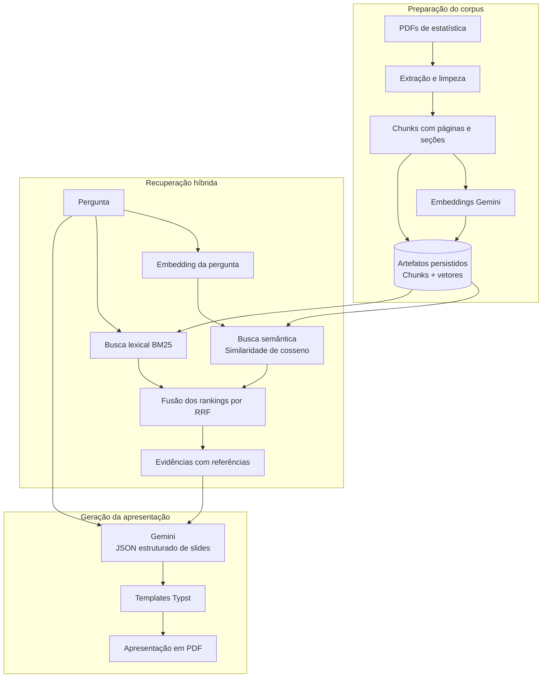

# Stats RAG

Para executar como aplicativo web, consulte [DEPLOY.md](DEPLOY.md).
A interface Streamlit reutiliza o índice salvo e permite consultar os livros e gerar slides.

## Visão geral

O Stats RAG é um projeto de **RAG (Retrieval-Augmented Generation)** para estudar estatística a partir de capítulos de livros. O usuário faz uma pergunta, o sistema localiza trechos relacionados no corpus e utiliza essas evidências para gerar uma apresentação com referências às fontes.

O fluxo tem três partes. Na **preparação**, os PDFs são convertidos em texto, divididos em chunks e associados a páginas e seções. O Gemini gera embeddings desses trechos, que são persistidos para reutilização. Na **recuperação**, a pergunta é comparada aos documentos por duas buscas complementares: BM25, que considera os termos do texto, e similaridade de cosseno, que compara os embeddings. Os rankings são combinados por RRF para selecionar as evidências.

Na **geração**, o Gemini recebe a pergunta e as evidências selecionadas e devolve um JSON com o conteúdo dos slides. O Python associa as citações aos documentos e páginas; os templates Typst organizam esse conteúdo e compilam a apresentação em PDF.



O projeto é executado em [project_nlp.ipynb](project_nlp.ipynb), preparado para Google Colab. O corpus atual contém os capítulos `ISLP-5.pdf` (Resampling Methods), `ISLP-7.pdf` (Moving Beyond Linearity) e `ISLP-8.pdf` (Tree-Based Methods). Os textos permanecem em inglês, e os slides são gerados em português brasileiro.

A extração, o chunking, a busca lexical, a comparação dos vetores e a compilação dos slides são locais. As chamadas ao Gemini produzem os embeddings que ainda não estão em cache e o conteúdo da apresentação. Os artefatos salvos permitem retomar o trabalho sem vetorizar novamente todo o corpus.

## Organização e execução

| Caminho | Papel |
| --- | --- |
| `project_nlp.ipynb` | Configurações e execução do fluxo completo |
| `corpus/` | PDFs consultados |
| `rag_artefatos.py` | Cache, persistência incremental e validações do índice |
| `artifacts/manifest.json` | Configurações, contagens e hashes dos artefatos |
| `artifacts/documentos/` | Chunks e metadados por PDF, em JSONL |
| `artifacts/embeddings/` | Vetores por configuração e PDF, em NPZ |
| `templates_typst_v2/` | Layouts, fontes, temas e gerador de slides |
| `output/` | JSON de slides, fontes, PDF e prévias |

Abra o notebook no Colab e execute as etapas na ordem descrita abaixo. A célula inicial instala `pypdf`, `google-genai` e `rank-bm25`, além de `tiktoken==0.12.0` e `typst==0.15.0`. Confira o corpus e as configurações antes de preparar o índice; depois, defina a pergunta, inspecione a recuperação e execute a geração dos slides.

As configurações ficam nas células de cada etapa. As tabelas seguintes descrevem os valores definidos no notebook e os efeitos das principais variáveis. Os nomes de modelos refletem essa configuração; esta documentação foi conferida por leitura do código e do manifesto, sem novas chamadas à API ou avaliação de qualidade da recuperação.

## Etapas e variáveis

### 1. Localizar o corpus e os arquivos do projeto

O notebook define os PDFs de entrada e a pasta de trabalho. Quando faltam arquivos necessários, recupera do GitHub os componentes previstos no fluxo.

| Variável | Valor atual | Função |
| --- | --- | --- |
| `REPOSITORIO_GITHUB` | `lucasarauj0h/stats-rag` | Repositório de origem dos arquivos e artefatos publicados |
| `BRANCH_GITHUB` | `main` | Branch consultada nos downloads |
| `ARQUIVOS_PDF` | `ISLP-5.pdf`, `ISLP-7.pdf`, `ISLP-8.pdf` | Define os documentos que devem compor o corpus |
| `PASTA_GITHUB` | `/content/stats-rag` no Colab; diretório atual fora dele | Raiz dos arquivos locais |
| `PDF_PATHS` | Caminhos em `PASTA_GITHUB / "corpus"` | Lista dos PDFs a processar |
| `PASTA_ARTEFATOS` | `PASTA_GITHUB / "artifacts"` | Destino dos chunks, vetores e manifesto |

As validações esperam todos os PDFs configurados, com IDs de chunks únicos e correspondência entre textos e vetores. Ao mudar o corpus, atualize também os artefatos.

### 2. Extrair e limpar o texto dos PDFs

O `pypdf` extrai o texto página a página com `extraction_mode="plain"`. A limpeza normaliza caracteres e trata padrões identificados na conversão, mantendo diagnósticos por página.

| Variável | Valor atual | Função |
| --- | --- | --- |
| `REMOVER_MARCADORES` | `True` | Remove linhas que correspondem aos padrões de marcadores gráficos |
| `REMOVER_GLIFOS` | `True` | Remove linhas reconhecidas como códigos de glifos não decodificados |
| `REMOVER_CABECALHOS` | `True` | Remove cabeçalhos reconhecidos pelas regras cadastradas |
| `REMOVER_REPETICOES` | `True` | Remove sequências repetidas consecutivamente conforme os limites abaixo |
| `CORRIGIR_HIFENIZACAO` | `True` | Une partes separadas por hífen seguido de quebra de linha |
| `MIN_REPETICOES` | `10` | Quantidade mínima de repetições para a regra de remoção |
| `MAX_TAMANHO_SEQUENCIA` | `80` | Limite do tamanho da unidade procurada na regra de repetição |
| `VERSAO_LIMPEZA` | `"5"` | Identifica a versão das regras na configuração e na identidade dos chunks |

As regras são heurísticas, e alguns cabeçalhos cadastrados são específicos do capítulo 5. Os diagnósticos permitem revisar as alterações. Esta etapa não executa OCR; fórmulas, tabelas e a ordem do texto devem ser conferidas no PDF original quando necessário.

### 3. Criar chunks e associar páginas e seções

O texto limpo de cada PDF é reunido e dividido em janelas medidas pelo **tiktoken**, executado localmente. A referência a `gpt-3.5-turbo` seleciona a codificação usada para o recorte; embeddings e slides são produzidos pelo Gemini.

| Variável | Valor atual | Função |
| --- | --- | --- |
| `CHUNK_SIZE` | `500` | Tamanho máximo nominal de cada janela, em tokens do tiktoken |
| `OVERLAP` | `100` | Quantidade nominal de tokens compartilhados entre janelas consecutivas |
| `MAX_CHUNKS` | `5000` | Limite por PDF; excedê-lo interrompe a etapa |
| `MODELO_TOKENIZADOR` | `"gpt-3.5-turbo"` | Codificação obtida por `tiktoken.encoding_for_model(...)` |
| `DOC_ID` | `None` | Permite informar uma identidade de referência; sem ela, a identidade deriva do PDF e da configuração |

Com 500 tokens e overlap de 100, o avanço nominal é de 400 tokens. Os intervalos abaixo têm início inclusivo e fim exclusivo:

```text
Chunk 0: [   0,  500)
Chunk 1: [ 400,  900)  ← repete os tokens [400, 500)
Chunk 2: [ 800, 1300)  ← repete os tokens [800, 900)
```

A janela limita a unidade de recuperação, enquanto o overlap preserva contexto nas bordas. A sobreposição também aumenta o texto processado e pode gerar resultados semelhantes. O código ajusta as bordas para preservar caracteres UTF-8, e o último chunk pode ser menor. A contagem do tiktoken pode diferir da contagem usada pelo Gemini.

Cada chunk registra `chunk_id`, `doc_id`, `content`, `source`, páginas e intervalos de tokens. A função `identificar_secoes_nos_chunks(...)` acrescenta `section_title`, `section_path` e as seções atravessadas, usando regras locais. Seu parâmetro `max_linhas_titulo=3` limita a montagem de títulos em várias linhas. A seção principal é a de maior interseção com o chunk.

Essa identificação acrescenta metadados aos recortes existentes: um chunk pode atravessar páginas ou seções do mesmo PDF. Os valores 500/100 são uma configuração inicial, sem avaliação comparativa que estabeleça sua superioridade para todo o corpus.

### 4. Gerar ou reutilizar embeddings

O provedor é o **Google Gemini**, pelo SDK `google-genai`. A chamada `cliente_embeddings.models.embed_content(...)` produz um vetor por entrada, que é validado e normalizado em L2.

| Variável ou campo | Valor atual | Função |
| --- | --- | --- |
| `MODELO_EMBEDDING` | `"gemini-embedding-2"` | Modelo usado para vetorizar documentos e perguntas |
| `DIMENSAO_EMBEDDING` | `3072` | Dimensão dos vetores; o notebook também aceita 768 e 1536 |
| `TAMANHO_LOTE` | `10` | Máximo de entradas por lote de geração |
| `MAX_TENTATIVAS` | `3` | Limite de tentativas por lote para os erros temporários previstos |
| `GERAR_EMBEDDING_QUERY` | `False` | Desativa a vetorização antecipada da pergunta nesta etapa |
| `config_embeddings["formato_documento"]` | `title: none \| text: {content}` | Texto formatado enviado para representar cada chunk |
| `config_embeddings["formato_query"]` | `task: search result \| query: {content}` | Texto formatado enviado para representar a pergunta |
| `config_embeddings["normalizacao"]` | `L2` | Padroniza a norma dos vetores |
| `config_embeddings["dtype"]` | `float32` | Tipo numérico da matriz NumPy |
| `GEMINI_API_KEY` | Informada em execução | Chave obtida do ambiente ou por `getpass` |

O título e a seção continuam nos metadados, mas o texto do embedding usa `title: none` e o conteúdo do chunk. A pergunta usa o mesmo modelo e dimensão do índice documental. Manter essa compatibilidade permite comparar os vetores por cosseno.

O cache considera modelo, dimensão e hash do texto formatado. Antes de novas chamadas, o notebook procura vetores compatíveis nos artefatos locais e, quando necessário, nos publicados no GitHub. Somente entradas ausentes ou alteradas precisam de novos embeddings. A chave não integra os artefatos persistidos.

### 5. Salvar e carregar o índice

[rag_artefatos.py](rag_artefatos.py) salva os chunks e os vetores separadamente por PDF, assim que cada documento fica pronto. O notebook reúne os vetores em um índice em memória para a busca.

| Variável | Conteúdo | Função |
| --- | --- | --- |
| `ARQUIVO_INDICE` | `PASTA_ARTEFATOS / "manifest.json"` | Caminho do manifesto usado para salvar e carregar o índice |
| `CONFIG_CHUNKING` | Tamanho, overlap, tokenizer e versão da limpeza | Registra a configuração que originou os chunks |
| `cache_embeddings` | Dicionário de vetores na sessão | Evita repetir a vetorização de entradas já disponíveis |
| `indice_embeddings` | Matriz, IDs, hashes dos conteúdos e configuração | Mantém a associação entre cada texto e seu vetor |
| `chunks` | Lista de textos e metadados | Corpus utilizado pela busca e pela montagem das referências |

O manifesto registra hashes SHA-256 dos PDFs e artefatos. Na carga, o código verifica configuração, integridade, IDs e associação entre textos e vetores. Os formatos estão descritos em [artifacts/README.md](artifacts/README.md).

| Alteração | O que executar novamente |
| --- | --- |
| Somente a pergunta | Busca; os embeddings dos documentos são reutilizados |
| BM25, RRF, candidatos ou top-k | Busca, reutilizando os vetores |
| Texto, limpeza, chunking ou tokenizer | Preparação e atualização do índice; entradas idênticas e compatíveis podem reutilizar vetores |
| Modelo, dimensão ou formato do embedding | Construção do índice na nova configuração |
| Tema ou conteúdo dos slides | Etapa de geração ou compilação correspondente |

No Colab, `/content/stats-rag` é temporário. Baixe ou publique os artefatos atualizados antes de encerrar a sessão; o notebook não faz upload automático para o GitHub.

### 6. Definir a pergunta e inspecionar a busca semântica

A pergunta recebe um embedding, e o NumPy calcula a similaridade de cosseno com todos os vetores do índice. A comparação é local; a API só é necessária para o vetor da pergunta quando ele ainda não está no cache da sessão.

| Variável | Valor ou conteúdo | Função |
| --- | --- | --- |
| `QUERY` | Pergunta definida no bloco de busca | Orienta a recuperação e a geração dos slides |
| `TOP_K` | `6` na busca semântica isolada | Limita os resultados exibidos nessa inspeção |
| `vetor_query` | Embedding da pergunta | Representação utilizada na comparação por cosseno |
| `resultados_semanticos` | Ranking com similaridades e chunks | Permite inspecionar quais trechos ficaram mais próximos da pergunta |

Os blocos de preparação de embeddings inicializam `QUERY=""`; defina a pergunta depois deles, no bloco de busca. `GERAR_EMBEDDING_QUERY=False` controla apenas a vetorização antecipada: as células de busca continuam obtendo o vetor quando executadas. A mesma pergunta pode reutilizar esse vetor entre a inspeção semântica e a busca híbrida na mesma sessão.

### 7. Executar a busca híbrida: BM25 + cosseno + RRF

O fluxo principal combina a lista semântica com uma lista lexical produzida por `rank_bm25.BM25Okapi`. O BM25 considera os termos de `content`, sem pesos próprios para título ou seção.

| Variável | Valor atual | Função |
| --- | --- | --- |
| `TOP_K` | `5` na célula híbrida | Limita a lista semântica exibida para comparação; redefine o valor da etapa anterior |
| `TOP_K_HIBRIDO` | `5` | Quantidade máxima de resultados após a fusão |
| `CANDIDATOS_POR_BUSCA` | `20` | Máximo de candidatos de cada ranking enviados ao RRF |
| `BM25_K1` | `1.5` | Controla a saturação do ganho por repetição de um termo |
| `BM25_B` | `0.75` | Controla a normalização pelo comprimento do chunk |
| `RRF_K` | `60` | Constante que suaviza as diferenças entre posições na fusão |
| `resultados_hibridos` | Ranking final com chunks e scores | Evidências disponíveis para a geração dos slides |

O tokenizer lexical é aplicado tanto aos chunks quanto à pergunta:

```python
def tokenizar_bm25(texto):
    texto = unicodedata.normalize("NFC", texto).casefold()
    return re.findall(r"\d+(?:[.,]\d+)*|[^\W_]+", texto)
```

Ele preserva letras Unicode e números decimais, separando `k-fold` em `k` e `fold`. Não aplica remoção explícita de stopwords, stemming, tradução ou remoção de acentos. Assim, uma pergunta em português pode ter pouca correspondência lexical com o corpus em inglês. Esse tokenizer tem função diferente do tiktoken usado para medir as janelas.

O BM25 é reconstruído em memória em cada busca híbrida. Entram na lista lexical somente chunks com algum termo da pergunta, sem exigir score positivo. Os candidatos são ordenados por score e, em empate, pela ordem no corpus. Como o BM25 mede palavras e o chunking mede tokens do tiktoken, os comprimentos lexicais ainda variam entre os chunks.

A fusão soma contribuições das posições dos chunks nas duas listas:

```text
score_RRF(chunk) = soma de 1 / (RRF_K + posição)
                  nos rankings em que o chunk aparece
```

As posições começam em 1. Um chunk presente nas duas listas recebe duas contribuições, com o mesmo peso para cada lista. Usar posições permite combinar rankings sem somar diretamente score BM25 e cosseno, que têm escalas diferentes. Em empate de RRF, o código prioriza a posição semântica e depois a ordem no corpus. Os resultados preservam os scores e as posições originais para inspeção.

### 8. Gerar o conteúdo estruturado dos slides

A célula **“[Oficial - Em Uso] Prompt estruturado para SLIDES”** usa os primeiros resultados híbridos como contexto. O Gemini recebe a pergunta, os textos e suas referências e devolve um JSON conforme o esquema de slides.

| Variável | Valor atual | Função |
| --- | --- | --- |
| `MODELO_GERACAO` | `"gemini-3.8-flash"` | Modelo configurado para gerar o conteúdo |
| `MAX_FONTES_CONTEXTO` | `3` | Máximo de evidências enviadas entre os resultados híbridos |
| `IDIOMA_RESPOSTA` | `"português brasileiro"` | Idioma solicitado no prompt |
| `NIVEL_RACIOCINIO` | `"low"` | Valor enviado em `thinking_level` |
| `MAX_TOKENS_GERACAO` | `8192` | Limite de saída solicitado à API |
| `EXIBIR_CONTEXTO` | `False` | Controla a impressão do contexto enviado ao modelo |
| `QUANTIDADE_SLIDES` | `4` | Máximo de slides permitido pelo esquema; o mínimo é 1 |
| `TEMA_SLIDES` | `"pixel"` | Prefixo dos templates; alternativa: `"ufabc"` |
| `TEMPLATES_PERMITIDOS` | `abertura`, `conceito`, `comparacao`, `formula` | Layouts disponíveis no esquema JSON |
| `AUTOR` | `"Lucas Souza"` | Autor acrescentado pelo Python |
| `DESCRICAO_SAIDA` | Instruções editoriais do bloco | Orienta a organização e a adaptação do conteúdo aos slides |
| `fontes_contexto` | Referências, chunks, documentos, páginas e seções | Rastreia as evidências enviadas |
| `dados_slides` | JSON retornado e complementado pelo Python | Entrada para a compilação Typst |

O contexto usa referências como `E1`, `E2` e `E3`. O prompt solicita afirmações sustentadas pelas fontes, citações próximas ao conteúdo e indicação de evidência insuficiente. O Python rejeita referências desconhecidas e monta os rodapés com documento e páginas do arquivo PDF.

Usar até 3 dos 5 resultados limita o contexto, mas pode deixar evidências relevantes fora da geração. A validação dos identificadores também não comprova a sustentação de cada afirmação; conteúdo e fórmulas precisam de revisão. As fórmulas devem usar sintaxe matemática Typst, sem delimitadores `$`.

O notebook também declara público-alvo e limites editoriais de caracteres e palavras. Na implementação atual, essas variáveis não são incorporadas automaticamente ao prompt ou ao esquema; as orientações efetivamente enviadas ficam em `DESCRICAO_SAIDA` e nas instruções montadas pela célula. As alternativas antigas de prompts permanecem comentadas.

### 9. Compilar e salvar a apresentação

O gerador recebe `dados_slides`, preenche os templates e compila o PDF. A geração de conteúdo também salva `output/slides.json` e `output/fontes.json` para inspeção.

| Variável | Valor atual | Função |
| --- | --- | --- |
| `PASTA_SAIDAS` | `PASTA_GITHUB / "output"` | Destino dos JSONs gerados |
| `PASTA_TEMPLATES` | `PASTA_GITHUB / "templates_typst_v2"` | Local dos layouts e do gerador |
| `NOME_PDF` | `"apresentacao_rag.pdf"` | Nome do PDF salvo em `output/` |
| `GERAR_PREVIAS` | `True` | Habilita a geração de prévias dos slides |
| `resultado_slides` | Caminhos e total de slides retornados pelo gerador | Permite localizar os arquivos produzidos |

O gerador verifica o encaixe do conteúdo nas caixas dos templates. Se o texto exceder os limites disponíveis, é necessário revisar sua distribuição ou extensão. Detalhes de layouts, fontes e compilação estão em [templates_typst_v2/README.md](templates_typst_v2/README.md). No Colab, a última etapa oferece o download do PDF.
